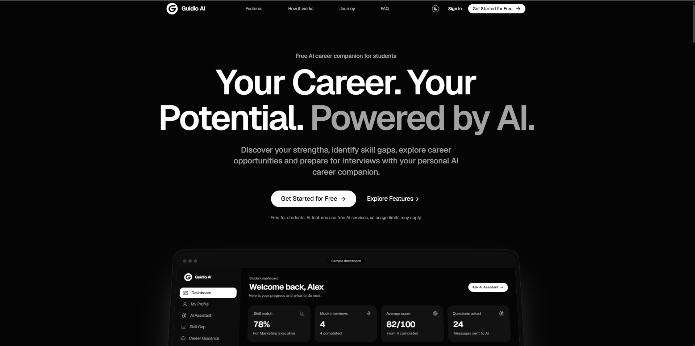
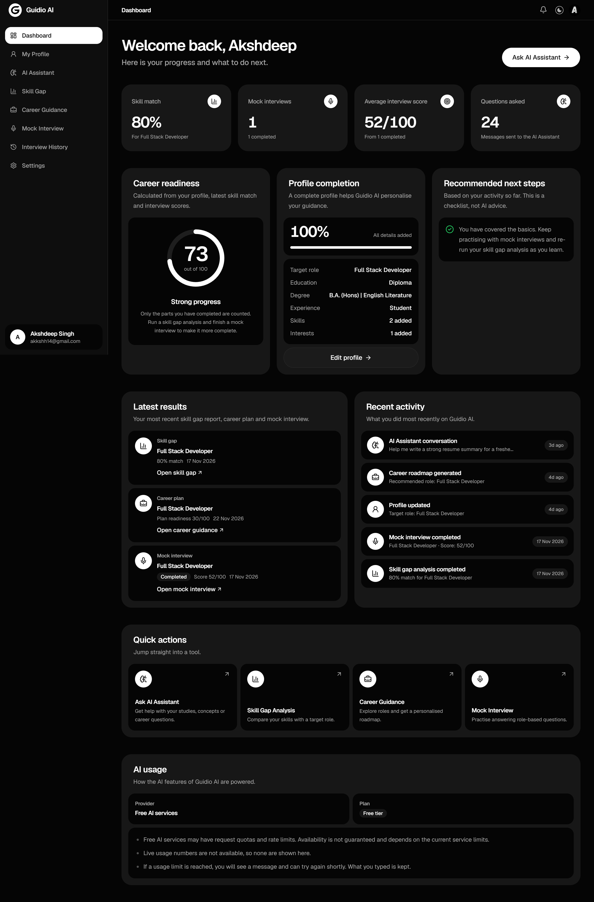
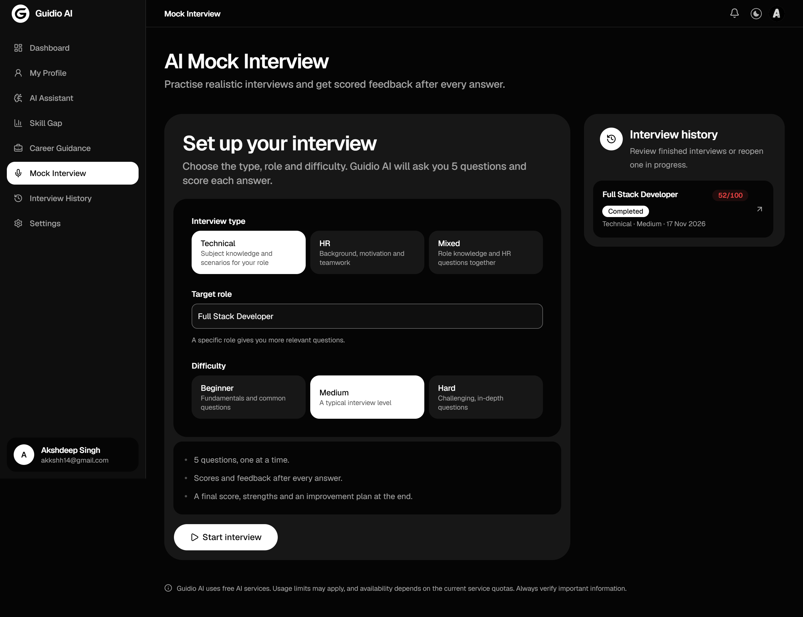

<div align="center">

# 🎓 Guidio AI

### Your Career. Your Skills. Your Future.

**An AI-powered career development platform built to help students discover their potential, identify skill gaps, explore career opportunities, and become job-ready.**

<br />

[](https://react.dev/)
[](https://vite.dev/)
[](https://tailwindcss.com/)
[](https://nodejs.org/)
[](https://www.mongodb.com/)

<br />

[Features](#-what-guidio-ai-offers) ·
[Architecture](#-system-architecture) ·
[Tech Stack](#-technology-stack) ·
[Installation](#-getting-started) ·
[Deployment](#-deployment)

<br />

**Discover → Analyse → Learn → Practise → Achieve**

</div>

---

## About the Project

Choosing the right career is not always easy.

Students often have the motivation to succeed but lack clarity about which skills to develop, which career path to follow, how to prepare for interviews, and what steps to take next.

**Guidio AI is designed to bridge that gap.**

It is a full-stack AI-powered platform that brings career guidance, skill-gap analysis, personalised learning roadmaps, mock interviews, and an intelligent study assistant into one unified experience.

Instead of navigating multiple disconnected tools, students can use one platform to understand where they stand and plan where they want to go.

### The Guidio AI Approach

```text
       YOUR PROFILE
             |
             ▼
      SKILL ANALYSIS
             |
             ▼
      CAREER GUIDANCE
             |
             ▼
    PERSONAL LEARNING PLAN
             |
             ▼
     PROJECT RECOMMENDATIONS
             |
             ▼
     AI MOCK INTERVIEWS
             |
             ▼
       CAREER READINESS
```

---

## ✨ What Guidio AI Offers

Guidio AI brings together five major AI-powered experiences.

<table>
<tr>
<td width="50%">

### 🤖 AI Student Assistant

An intelligent study companion that helps students understand concepts, solve problems, explore technical topics, and learn through conversational AI.

</td>
<td width="50%">

### 🧠 Skill Gap Analysis

Evaluates existing skills against a target role, identifies missing competencies, and generates personalised learning recommendations.

</td>
</tr>
<tr>
<td width="50%">

### 🧭 AI Career Guidance

Provides career recommendations, alternative roles, readiness insights, learning roadmaps, and project suggestions.

</td>
<td width="50%">

### 🎤 AI Mock Interviews

Creates interactive technical, HR, and mixed interviews with configurable difficulty, answer evaluation, scoring, and feedback.

</td>
</tr>
<tr>
<td width="50%">

### 📊 Student Dashboard

A centralised space for tracking profile completion, career readiness, skill development, interview activity, and recommended next steps.

</td>
<td width="50%">

### 👤 Personalised Student Profile

Maintains education, experience, skills, interests, and career goals to support personalised recommendations.

</td>
</tr>
</table>

---

## 🚀 Platform Highlights

| Area | Capabilities |
|---|---|
| Authentication | Clerk sign-in, sign-up, protected routes |
| Onboarding | Four-step student profile setup |
| Dashboard | Backend-driven progress and activity |
| AI Assistant | Streaming responses and conversation history |
| Skill Analysis | Skill matching, gaps, priorities, learning plans |
| Career Guidance | Career paths, readiness, roadmaps |
| Mock Interviews | Technical, HR, mixed, multiple difficulty levels |
| Interview History | Scores, feedback, and previous sessions |
| Profile Management | Education, skills, interests, career goals |
| Notifications | Weekly reminders through Inngest |
| User Experience | Responsive interface and theme preferences |

---

## 📸 Application Preview

> Screenshots are stored in `docs/screenshots/`. Replace these examples with actual application screenshots.

### 01 — Landing Page

<p align="center">
  
</p>

### 02 — Student Dashboard

<p align="center">
  
</p>

### 03 — AI Mock Interview

<p align="center">
  
</p>

---

## 🏗️ System Architecture

Guidio AI uses a client-server architecture with a React frontend, an Express backend, MongoDB persistence, and multiple AI providers.

```text
┌──────────────────────────────────────────────┐
│                  STUDENT                     │
│             Browser / Mobile Web             │
└──────────────────────┬───────────────────────┘
                       │
                       ▼
┌──────────────────────────────────────────────┐
│               REACT FRONTEND                 │
│                                              │
│       React 19 · Vite · Tailwind CSS 4       │
│          React Router · Clerk                │
└──────────────────────┬───────────────────────┘
                       │
                  Authenticated
                    REST API
                       │
                       ▼
┌──────────────────────────────────────────────┐
│               EXPRESS BACKEND                │
│                                              │
│       Authentication · Validation            │
│       Rate Limiting · Controllers             │
│       Services · AI Orchestration             │
└───────────────┬──────────────────┬───────────┘
                │                  │
                ▼                  ▼
┌────────────────────────┐  ┌──────────────────┐
│       DATABASE         │  │   AI PROVIDERS   │
│                        │  │                  │
│   MongoDB Atlas        │  │   1. Gemini      │
│   Prisma ORM           │  │   2. Groq         │
│                        │  │   3. Ollama      │
└────────────────────────┘  └──────────────────┘
                │
                ▼
┌──────────────────────────────────────────────┐
│             BACKGROUND PROCESSING            │
│                    Inngest                   │
│             Weekly Readiness Reminders       │
└──────────────────────────────────────────────┘
```

### Security Design

Security-sensitive operations are handled by the backend.

- Clerk session verification.
- Protected API endpoints.
- Server-side database access.
- Server-side AI provider communication.
- Input validation.
- Rate limiting.
- Security headers.
- Environment-based secret management.

The browser does not directly access MongoDB or private AI provider credentials.

---

## 🧠 AI Provider Strategy

Guidio AI uses multiple AI providers to improve service availability.

```text
             AI REQUEST
                 |
                 ▼
              GEMINI
                 |
          Request Successful?
             /       \
           YES        NO
            |          |
            ▼          ▼
         RESPONSE     GROQ
                       |
                Request Successful?
                    /       \
                  YES        NO
                   |          |
                   ▼          ▼
                RESPONSE   OLLAMA
```

### Provider Responsibilities

| Provider | Purpose |
|---|---|
| Google Gemini | Primary AI provider |
| Groq | Fallback AI provider |
| Ollama | Local AI fallback |

Additional handling includes:

- HTTP 429 rate-limit detection.
- Clear user-facing wait messages.
- Preservation of typed messages.
- Protection against repeated failing requests.
- Backend-only provider credentials.

---

## 🛠️ Technology Stack

### Frontend

| Technology | Purpose |
|---|---|
| React 19 | Component-based user interface |
| Vite 8 | Development and build tooling |
| JavaScript / JSX | Application language |
| React Router 8 | Client-side navigation |
| Tailwind CSS 4 | Utility-first styling |
| Base UI | Accessible UI primitives |
| Lucide | Interface icons |
| Clerk | Frontend authentication |

### Backend

| Technology | Purpose |
|---|---|
| Node.js | JavaScript runtime |
| Express 5 | Backend API framework |
| Prisma 6 | Database ORM |
| MongoDB | Database |
| Zod | Request validation |
| Helmet | Security headers |
| express-rate-limit | API rate limiting |
| Inngest | Background jobs |

### Artificial Intelligence

- Google Gemini
- Groq
- Ollama

### Infrastructure

| Service | Purpose |
|---|---|
| Vercel | Frontend deployment |
| Render | Backend deployment |
| MongoDB Atlas | Cloud database |
| Inngest | Background processing |
| Clerk | Authentication infrastructure |

---

## 📁 Project Structure

```text
Guidio-Ai/
│
├── guidio-frontend/
│   ├── public/
│   ├── src/
│   │   ├── app/
│   │   ├── components/
│   │   │   ├── common/
│   │   │   └── ui/
│   │   ├── features/
│   │   │   ├── assistant/
│   │   │   ├── auth/
│   │   │   ├── career/
│   │   │   ├── dashboard/
│   │   │   ├── interview/
│   │   │   ├── landing/
│   │   │   ├── onboarding/
│   │   │   ├── profile/
│   │   │   ├── settings/
│   │   │   └── skill-gap/
│   │   ├── hooks/
│   │   ├── layouts/
│   │   ├── lib/
│   │   ├── pages/
│   │   ├── styles/
│   │   ├── App.jsx
│   │   └── main.jsx
│   ├── .env.example
│   └── vercel.json
│
├── guidio-backend/
│   ├── prisma/
│   │   └── schema.prisma
│   ├── src/
│   │   ├── ai/
│   │   ├── config/
│   │   ├── controllers/
│   │   ├── inngest/
│   │   ├── middleware/
│   │   ├── routes/
│   │   ├── services/
│   │   ├── utils/
│   │   └── server.js
│   └── .env.example
│
└── README.md
```

---

## ⚙️ Getting Started

Follow these instructions to run Guidio AI on your local machine.

### Prerequisites

Make sure you have installed:

- Node.js 22.22+
- npm
- Git
- Visual Studio Code

Create accounts for the required services:

| Service | Purpose |
|---|---|
| [Clerk](https://clerk.com/) | Authentication |
| [MongoDB Atlas](https://www.mongodb.com/atlas) | Database |
| [Google AI Studio](https://aistudio.google.com/) | Gemini API |
| [GitHub](https://github.com/) | Source control |

Optional services:

- [Groq](https://console.groq.com/)
- [Ollama](https://ollama.com/)
- [Inngest](https://www.inngest.com/)

Verify your installation:

```powershell
node -v
npm -v
git --version
```

### 1. Clone the Repository

```powershell
git clone https://github.com/<your-username>/<your-repository>.git

cd Guidio-Ai
```

### 2. Install Frontend Dependencies

```powershell
cd guidio-frontend

npm install

copy .env.example .env.local
```

### 3. Install Backend Dependencies

Open another terminal:

```powershell
cd guidio-backend

npm install

copy .env.example .env

npx prisma generate
```

For a completely new MongoDB database, synchronize the schema:

```powershell
npx prisma db push
```

> This project uses Prisma's `db push` workflow for MongoDB schema synchronization.

---

## 🔑 Environment Configuration

### Frontend

Create `guidio-frontend/.env.local`:

```env
VITE_API_BASE_URL=http://localhost:5000
VITE_CLERK_PUBLISHABLE_KEY=pk_test_...
```

### Backend

Create `guidio-backend/.env`:

```env
PORT=5000
NODE_ENV=development

CORS_ORIGINS=http://localhost:5173
FRONTEND_LOCAL=http://localhost:5173

CLERK_SECRET_KEY=sk_test_...
CLERK_PUBLISHABLE_KEY=pk_test_...

DATABASE_URL=mongodb+srv://<user>:<password>@<cluster>.mongodb.net/guidio-ai

GEMINI_API_KEY=...
GROQ_API_KEY=...

GEMINI_MODEL=...
GROQ_MODEL=...

INNGEST_DEV=1
```

**Important security notes:**

- Never commit `.env` or `.env.local`.
- Never expose Clerk secret keys.
- Never expose database connection strings.
- Never place AI provider API keys in frontend variables.
- Only frontend configuration intended for public use should use the `VITE_` prefix.

---

## ▶️ Run the Application

Guidio AI requires two development servers.

### Backend

```powershell
cd guidio-backend

npm run dev
```

Health endpoint:

```text
http://localhost:5000/api/health
```

Expected response:

```json
{
  "status": "healthy"
}
```

### Frontend

```powershell
cd guidio-frontend

npm run dev
```

Open the application:

**http://localhost:5173**

---

## 🔌 API Overview

All endpoints except `/api/health` require an authenticated Clerk session.

```http
Authorization: Bearer <Clerk session token>
```

### Main API Routes

| Method | Endpoint | Description |
|---|---|---|
| GET | `/api/health` | Health check |
| GET | `/api/users/me` | Current user synchronization |
| GET | `/api/profile` | Retrieve student profile |
| PUT | `/api/profile` | Update student profile |
| GET | `/api/dashboard` | Dashboard information |
| GET | `/api/assistant/conversations` | List conversations |
| POST | `/api/assistant/conversations` | Create conversation |
| POST | `/api/assistant/conversations/:id/messages` | Stream AI response |
| GET | `/api/career/plans` | Retrieve career plans |
| POST | `/api/career/plans` | Generate career plan |
| GET | `/api/skill-gap/reports` | Retrieve skill reports |
| POST | `/api/skill-gap/reports` | Generate skill report |
| GET | `/api/interviews` | Retrieve interviews |
| POST | `/api/interviews` | Create interview |
| POST | `/api/interviews/:id/questions/:questionId/answer` | Submit interview answer |
| GET | `/api/reminders` | Retrieve notifications |
| PATCH | `/api/reminders/:id/read` | Mark notification as read |
| PATCH | `/api/reminders/read-all` | Mark all notifications as read |
| — | `/api/inngest` | Inngest integration |

---

## ☁️ Deployment

The recommended deployment architecture is:

```text
                 GITHUB
                    |
          ┌─────────┴─────────┐
          ▼                   ▼
       VERCEL               RENDER
     Frontend             Backend
                              |
                              ▼
                       MONGODB ATLAS
                              |
                              ▼
                       AI PROVIDERS
```

### Frontend — Vercel

| Setting | Value |
|---|---|
| Root Directory | `guidio-frontend` |
| Framework | Vite |
| Build Command | `npm run build` |
| Output Directory | `dist` |
| Node.js | 22.x |

Environment variables:

```env
VITE_API_BASE_URL=https://your-backend.onrender.com
VITE_CLERK_PUBLISHABLE_KEY=pk_test_...
```

The included `guidio-frontend/vercel.json` handles single-page application routing.

### Backend — Render

| Setting | Value |
|---|---|
| Root Directory | `guidio-backend` |
| Runtime | Node |
| Build Command | `npm ci && npx prisma generate` |
| Start Command | `npm start` |
| Health Check | `/api/health` |

Configure the required backend environment variables in Render.

Do not manually set the `PORT` variable; Render provides it automatically.

### Database — MongoDB Atlas

Configure your database connection string through:

```env
DATABASE_URL=...
```

For production, configure appropriate database network access and use strong credentials.

### Connect Frontend and Backend

Set the backend's allowed frontend origin:

```env
CORS_ORIGINS=https://your-app.vercel.app
```

Make sure the URL exactly matches your deployed frontend origin.

---

## 🛡️ Security

Guidio AI uses server-side handling for sensitive operations.

Security considerations include:

- Clerk authentication verification.
- Protected API routes.
- Backend-only AI credentials.
- Backend-only database access.
- Request validation.
- Rate limiting.
- Security headers.
- Environment-based configuration.

If a real secret is exposed, revoke or rotate it immediately. Removing it from the latest commit does not remove it from Git history.

---

## 📚 Additional Documentation

For more detailed implementation and setup instructions:

| Documentation | Description |
|---|---|
| [Frontend README](guidio-frontend/README.md) | Frontend setup, scripts, and development |
| [Backend README](guidio-backend/README.md) | Backend architecture, configuration, and API documentation |

---

## 🗺️ Future Roadmap

Potential future improvements:

- [ ] Production Clerk configuration.
- [ ] Resume analysis.
- [ ] Job recommendation system.
- [ ] Advanced career analytics.
- [ ] Dedicated academic branch and field-of-study fields.
- [ ] More AI providers.
- [ ] Expanded career paths.
- [ ] Learning resource recommendations.
- [ ] Student progress tracking.
- [ ] Additional interview formats.
- [ ] Mobile application.
- [ ] Production-grade monitoring.

---

## 💡 Project Vision

Guidio AI is built around a simple belief:

> **Every student deserves clarity, direction, and the right tools to build a successful career.**

The goal is not simply to provide AI-generated answers. It is to create a structured student-development experience that helps learners understand their current abilities, make informed career decisions, improve their skills, and prepare for real opportunities.

**One platform. Multiple possibilities. A clearer path forward.**

---

## 🤝 Contributing

Contributions, suggestions, and bug reports are welcome.

1. Fork the repository.
2. Create a feature branch.
3. Make your changes.
4. Run the available lint and build checks.
5. Submit a Pull Request.

```bash
git checkout -b feature/your-feature
git add .
git commit -m "feat: describe your change"
git push origin feature/your-feature
```

---

## 📄 License

Add your preferred license to the repository. For example, MIT License.

---

<div align="center">

# 🎓 Guidio AI

### Learn Smarter. Plan Better. Build Your Career.

**Designed for students. Powered by AI. Built for the future.**

<br />

If you like this project, consider giving the repository a ⭐

</div>
